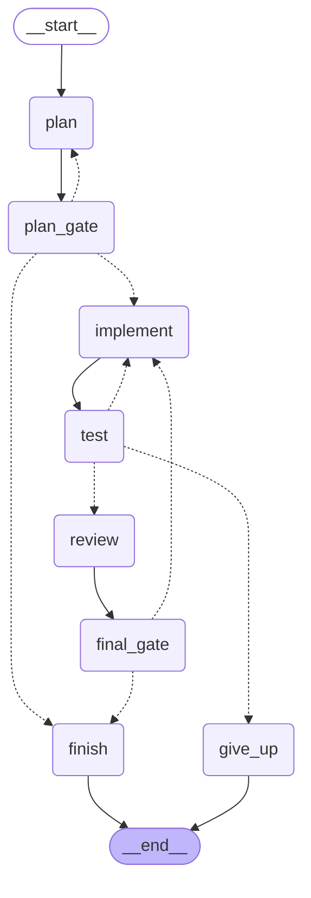

# coding 工作流结构

由 `graph.get_graph().draw_mermaid()` 自动生成，改图后重新生成即可（见文末）。



- 实线 `-->`：必经边
- 虚线 `-.->`：条件边（`route_after_*` 返回的目标）
- `plan_gate` / `final_gate`：`interrupt()` 断点，人工 approve / revise / abort

## 生成 / 更新

```bash
source env.sh
python -c "from src.workflows.coding import build; print(build().compile().get_graph().draw_mermaid())"
```

渲染成 PNG 需要外网 `mermaid.ink`（本机不通），或者本地装 graphviz：

```bash
python -c "from src.workflows.coding import build; open('docs/coding-graph.png','wb').write(build().compile().get_graph().draw_mermaid_png())"
```
